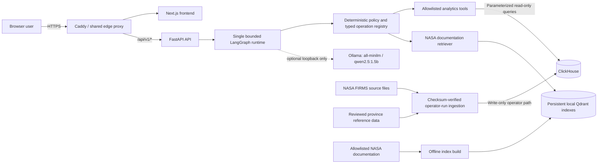

# Indonesia Wildfire Intelligence — LLM & RAG

Indonesia Wildfire Intelligence is a research-oriented application for exploring historical NASA FIRMS VIIRS hotspot detections in Indonesia. It combines deterministic geospatial and temporal analytics in ClickHouse with a bounded LangGraph workflow and retrieval over approved NASA documentation.

The application helps researchers, journalists, students, and environmental analysts investigate where and when satellite detections occurred, compare provinces or years, inspect maps and trends, and understand scientific terms and limitations. A hotspot is a satellite detection—not a confirmed wildfire incident, burned-area estimate, causal finding, forecast, or emergency alert.

## Features

- Historical VIIRS S-NPP hotspot exploration with date, province, and product filters.
- Maps, summaries, monthly trends, year comparisons, province comparisons, and rankings backed by typed API contracts.
- Parameterized, allowlisted, read-only ClickHouse analytics; the LLM cannot generate or execute SQL.
- One bounded LangGraph runtime for analytics, NASA-document retrieval, combined answers, clarification, and safe refusal.
- Persistent local Qdrant indexes with source manifests, embedding compatibility checks, and fail-closed startup.
- Deterministic extractive RAG and optional loopback-only Ollama generation/embeddings.
- English and Indonesian query handling, typed execution traces, quotas, concurrency limits, timeouts, and redacted structured logs.
- Next.js dashboard using MapLibre GL JS and Recharts.

## Technology stack

| Layer | Technologies |
|---|---|
| Frontend | Next.js 16, React 19, TypeScript, Tailwind CSS, MapLibre GL JS, Recharts, Vitest |
| API | Python 3.12, FastAPI, Pydantic, HTTPX, Uvicorn |
| Agent and RAG | LangGraph, LangChain components, Qdrant local storage, optional Ollama |
| Analytics | ClickHouse, fixed query catalog, Polars-based ingestion/validation tooling |
| Delivery | Docker, Docker Compose, Caddy, GitHub Actions, GitHub Container Registry |

No external cloud LLM adapter is currently active. `WILDFIRE_OPENAI_API_KEY` is reserved in a template but is not consumed by the runtime.

## Architecture



Ingestion and index construction are explicit operator jobs. There is no approved scheduled refresh worker, and chat content is never added to an index.

## Repository structure

```text
.
├── backend/                    FastAPI, LangGraph, RAG, repositories, tests
├── data/                       Ingestion, ClickHouse DDL, contracts, QA, provenance
├── docs/                       Product, architecture, API contracts, task status
├── frontend/                   Next.js UI and frontend tests
├── infrastructure/
│   ├── caddy/                  HTTPS reverse-proxy configuration
│   └── clickhouse/             Secure service-user initialization
├── .github/workflows/ci.yml    Tests, image builds, and GHCR publishing
├── docker-compose.prod.yml     Production service topology
└── DEPLOYMENT_BIZNET_GIO.md    VPS deployment and operations guide
```

Raw datasets, generated batches, ClickHouse files, vector indexes, model weights, caches, and secrets remain outside Git and Docker build contexts.

## Getting started

### Prerequisites

- Python 3.12+
- Node.js 22 and npm
- Docker Engine with Docker Compose v2 for the container workflow
- Optional: local ClickHouse and Ollama for live integration profiles

### Backend development

```bash
python3 -m venv backend/.venv
backend/.venv/bin/python -m pip install -e './backend[dev,rag]'
cp backend/.env.example backend/.env
cd backend
.venv/bin/uvicorn wildfire_api.main:app --reload
```

The safe development default uses mock analytics. To use ClickHouse, configure the read-only settings documented in `backend/.env.example` after applying the DDL and loading a verified batch.

Build the deterministic local NASA index before enabling local RAG:

```bash
cd backend
.venv/bin/python -m wildfire_api.rag.cli \
  --location data/qdrant-local-hashing \
  --embedding-provider hashing \
  --chunking-profile recursive-character-1400-200-v1 \
  --retrieval-profile hybrid_rrf
```

This command fetches the allowlisted NASA sources and therefore requires network access.

### Frontend development

```bash
cd frontend
cp .env.example .env.local
npm ci
npm run dev
```

The frontend reads its API mode and URL at server runtime. It never receives ClickHouse, model, or ingestion credentials.

### Database initialization and ingestion

Apply the migrations in order:

```bash
clickhouse-client --multiquery < data/clickhouse/migrations/001_d06_physical_model.sql
clickhouse-client --multiquery < data/clickhouse/migrations/002_d06_backend_reader_role.sql
clickhouse-client --multiquery < data/clickhouse/migrations/003_d08_multiyear_release.sql
```

Then create separate operator and read-only identities. Generate a checksum-verified batch with `data/scripts/ingest_firms_v1.py` and load it with `data/scripts/load_clickhouse_v1.py`. Exact safety, reconciliation, release activation, and rollback procedures are in `data/OPERATIONS_RUNBOOK.md` and `data/clickhouse/README.md`.

### Tests

```bash
backend/.venv/bin/ruff check backend
cd backend && .venv/bin/pytest
cd ..
backend/.venv/bin/python -m unittest discover -s data/tests -p 'test_*.py'
cd frontend
npm run lint
npm run typecheck
npm test
npm run build
```

Live ClickHouse, Qdrant, NASA, or Ollama checks are opt-in and require their documented dependencies.

## Docker

Create the external edge network once and prepare an environment file:

```bash
docker network create --subnet 172.30.0.0/24 wildfire_edge
cp .env.production.example .env.production
docker compose --env-file .env.production -f docker-compose.prod.yml config
docker compose --env-file .env.production -f docker-compose.prod.yml build backend frontend
```

Build the persistent NASA RAG index before first API startup:

```bash
docker compose --env-file .env.production -f docker-compose.prod.yml \
  --profile initialize run --rm rag-init
```

Start behind an existing shared reverse proxy:

```bash
docker compose --env-file .env.production -f docker-compose.prod.yml \
  up -d clickhouse backend frontend
```

For a standalone host where this project owns ports 80 and 443:

```bash
docker compose --env-file .env.production -f docker-compose.prod.yml \
  --profile edge up -d
```

Operational commands:

```bash
docker compose --env-file .env.production -f docker-compose.prod.yml ps
docker compose --env-file .env.production -f docker-compose.prod.yml logs -f --tail=200
docker compose --env-file .env.production -f docker-compose.prod.yml restart backend frontend
docker compose --env-file .env.production -f docker-compose.prod.yml stop
```

The named `clickhouse_data` and `rag_indexes` volumes are persistent. `stop`, `down`, image pulls, and container recreation do not delete them; never use `down --volumes` during routine updates.

## CI/CD

`.github/workflows/ci.yml` runs backend lint/tests, data tests, frontend lint/typecheck/tests/build, validates the production Compose file, and builds both application images. Pushes to `main` publish only immutable commit-SHA tags:

```text
ghcr.io/ridhotr27/indonesia-wildfire-intelligence-backend:<git-sha>
ghcr.io/ridhotr27/indonesia-wildfire-intelligence-frontend:<git-sha>
```

The workflow uses `GITHUB_TOKEN` with repository read and package write permissions. Production deployment is deliberately disabled; there is no SSH or VPS secret in CI.

## Data sources and attribution

- NASA FIRMS VIIRS S-NPP Collection 2 standard-processing hotspot detections are the sole wildfire-observation source.
- NASA FIRMS and Earthdata technical pages listed in `backend/resources/nasa_documents/manifest.json` form the approved RAG corpus.
- Province assignment uses the reviewed OSM-derived Indonesia administrative boundary baseline documented in `data/provenance/d03b_reusable_boundary.json` and requires the attribution recorded by the published data contract.

The locally accepted D08 release covers 2023–2025, but it is approved for local development only. Coverage includes known and unknown gaps documented by the metadata and data reports. Source files and generated batches are intentionally not published in Git. Consult `docs/DATA_FEASIBILITY.md`, `data/reports/`, and the provenance manifests before redistributing data or geometry.

Official source references already used by the project:

- https://firms.modaps.eosdis.nasa.gov/
- https://www.earthdata.nasa.gov/data/tools/firms

## Limitations

- Satellite hotspots are detections and may contain omissions, false positives, geolocation uncertainty, and coverage gaps.
- The system does not establish fire causes, severity, burned area, confirmed incidents, or future risk.
- RAG quality depends on the approved document corpus, chunking, embedding profile, and available evidence; insufficient evidence produces an abstention.
- Extractive mode is resource-efficient but less conversational. The evaluated Ollama profile requires more CPU/RAM and is restricted to loopback by design.
- Application rate limits are process-local; the production container deliberately runs one API worker.
- Q01 recorded a no-go release recommendation with live/manual evaluation gaps. Passing automated tests does not make the deployment production-approved.
- No automated refresh schedule, external cloud LLM adapter, public authentication system, or production deployment job is implemented.

## Project status

| Area | Status |
|---|---|
| Core ingestion, ClickHouse contracts, API, bounded agent, RAG, and frontend | Implemented with recorded local verification |
| D08 three-year dataset release | Accepted for local development only |
| Deterministic production container baseline | Prepared locally; not deployed |
| Semantic routing | Disabled in the production baseline; historical evaluation limitations remain documented |
| Local Ollama generation and embeddings | Optional/evaluated locally; not enabled in the VPS baseline |
| CI image publishing | Workflow prepared; not yet committed or run on GitHub |
| Production release | Not approved or deployed |

See `docs/TASKS.md`, `backend/reports/Q01_RELEASE_EVALUATION.md`, and `DEPLOYMENT_BIZNET_GIO.md` for authoritative status and remaining gates.

## Author

**Ridho Trivonanda**

Data Scientist & Data Engineer
GitHub: https://github.com/ridhotr27
