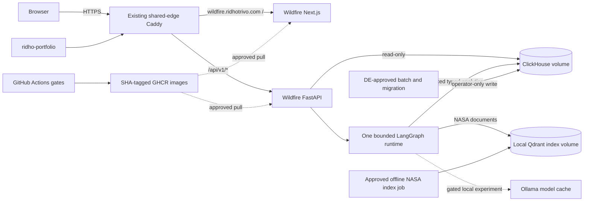

# R01 deployment plan — Indonesia Wildfire Intelligence

**Status:** Planning proposal; no deployment or release authorization
**Owner:** Tech Lead accountable; Lead DevOps Engineer prepares operational evidence
**Decision:** **NO-GO** for deployment on the current 4 GiB VPS and for public release. R01 remains `BACKLOG`.

## 1. Executive summary and evidence boundary

The target is a separate Wildfire Docker Compose project behind the existing `shared-edge` Caddy, leaving `ridho-portfolio` on `https://ridhotrivo.com`. Wildfire's intended public name is `wildfire.ridhotrivo.com`. The proposed application path is Next.js → FastAPI → one bounded LangGraph runtime → read-only ClickHouse and persistent local NASA-document Qdrant indexes, with optional local Ollama inference after a separate experiment. No Kubernetes or second public proxy is needed.

This document is a plan, not a claim that the host, images, model, data release, backups, or release tests are ready. The user supplied the VPS size (4 GiB RAM, 2 GiB swap, about 58 GB disk), installed Docker/Compose, portfolio, `ridho-portfolio` and `shared-edge` projects, and working portfolio HTTPS. None was independently checked on the VPS. There was no SSH, DNS query, GitHub run, image pull, live benchmark, or infrastructure change for this plan.

`docs/ARCHITECTURE.md` does not exist. This review used the approved `docs/TECHNICAL_DESIGN.md`, root `README.md`, `DEPLOYMENT_BIZNET_GIO.md`, `docs/TASKS.md`, `backend/reports/Q01_RELEASE_EVALUATION.md`, Compose, Dockerfiles, environment templates, backend configuration, and CI workflow. The older Q01 report contains historical wording that says Q01 should not be `DONE`; the later canonical `docs/TASKS.md` approval controls: Q01 is `DONE` **as a no-go evaluation**, and R01 is `BACKLOG` with no release approval.

## 2. Current assessment and gates

| Evidence | Current state | Consequence |
|---|---|---|
| `.github/workflows/ci.yml` | PR/main backend lint and tests, data tests, frontend lint/test/build/typecheck, Compose validation; successful main image builds publish SHA tags to GHCR. No deploy job. | Preserve all jobs and image dependency chain; verify actual remote run and package visibility before use. |
| `docker-compose.prod.yml` | Separate named project, private `data_plane`, external `wildfire_edge`, persistent ClickHouse and RAG volumes, resource caps, health checks, restart policies, optional `edge` Caddy and initialization jobs. | Do not start `edge` on the shared host; check external-network collision and actual Compose rendering. |
| Backend and frontend Dockerfiles | Non-root runtime users and HTTP process health checks. Backend `/api/v1/health` is process health, not full dependency readiness. | Add a separately reviewed readiness/smoke plan; do not infer ClickHouse/RAG/Ollama readiness from green health. |
| `.env.production.example` and deployment guide | Use `wildfire.ridhotrivonanda.com`, while the requested host is `wildfire.ridhotrivo.com`. | Reconcile domain, origin, API URL, DNS, Caddy, and certificate in a reviewed change. |
| Q01 and feature gates | Q01 closed with a no-go. Numeric live accuracy, human citation audit, hosted E2E p95, and manual/browser accessibility remain unmeasured in its record. LIR-07 failed its stated quality gates; LIR-12 is not ready. | Preserve thresholds; obtain a Tech Lead disposition and fresh representative release evidence. |
| R01 | `BACKLOG`, Tech Lead accountable, explicit release approval required. | Planning is authorized here. Claiming, private VPS deployment, and public release need separate decisions. |

The approved G0/G1/G2 contracts, DE-only ClickHouse writing, BE read-only serving, NASA-only wildfire observation source, bounded graph, exact analytics, and visible hotspot-detection caveats remain mandatory. The local D08 multi-year data release is not automatically a production data-release approval. The existing production Compose profile pins `degraded`, hashing/extractive RAG, and disabled semantic routing; this is not the optional Ollama profile.

## 3. Proposed architecture

Only Caddy publishes 80/443. ClickHouse uses the internal data network; API/UI join a dedicated, externally managed Wildfire edge network with scoped aliases. Before attaching the shared Caddy, verify its network membership, CIDR, routing, and `TRUSTED_PROXY_CIDRS`; never attach unrelated containers to the trusted edge network. Keep backend, frontend, ClickHouse, RAG, and model files in project-specific volumes, and use immutable image digests/SHA records for rollback. Retain `wildfire_clickhouse_data`, `wildfire_clickhouse_logs`, and `wildfire_rag_indexes` names through upgrades. An Ollama cache volume would be separate and must not be added until its architecture is approved.

**Ollama integration blocker:** `backend/src/wildfire_api/llm/ollama.py` accepts only HTTP loopback URLs. A backend container's `127.0.0.1` is not the host or another container. `backend/src/wildfire_api/core/config.py` also requires `qwen2.5:1.5b` and `all-minilm` for `local_grounded`. Therefore, a separate Ollama service and Qwen3 0.6B cannot be activated with environment values alone. BE must design and test a secure process boundary and any model-profile change, preserving no public Ollama port, typed validation, provenance, and fail-closed behavior. A single-network, container-DNS URL would currently fail validation. Do not work around it by exposing Ollama publicly.

## 4. VPS budget and LLM feasibility

The current runtime caps alone are ClickHouse 3 GiB + backend 1 GiB + frontend 0.5 GiB = **4.5 GiB**, excluding host OS, Docker, page cache, `ridho-portfolio`, `shared-edge`, and Ollama. Optional one-off `rag-init` and data-loader each allow another 1 GiB and must be scheduled separately. A 2 GiB swap file improves failure tolerance but does not provide acceptable working RAM or predictable inference latency. The deployment guide recommends at least 8 GiB for its non-Ollama baseline and 16 GiB for the optional `qwen2.5:1.5b` profile alongside a portfolio. Actual CPU count, portfolio memory, and disk availability are unverified.

| Planning envelope, **not measured** | Idle RAM | Peak/limit concern | Disk concern |
|---|---:|---|---|
| Ubuntu, Docker, Caddy, portfolio | Unknown; measure first | Must retain safety headroom | Existing usage unknown |
| ClickHouse | Unknown | Current cap 3 GiB; merges and initialization can spike | Data, parts, logs, backup staging |
| FastAPI/RAG and Next.js | Unknown | Current caps 1 GiB + 0.5 GiB | Images and index volume |
| Qwen3 0.6B Q4 experiment | Model file about **523 MB** per [Ollama's tag listing](https://ollama.com/library/qwen3/tags); working RAM additionally includes runtime and KV cache | Treat 0.8–1.5 GiB as a **test reservation**, not an observed peak; context and parallelism change it | Model cache plus pull/rollback headroom |

The 58 GB reported disk size must be checked as **free** space, not assumed available. Record `df -h`, `df -i`, Docker image/volume usage, ClickHouse data/log size, RAG indexes, model cache, and an off-host backup destination. Keep backups off this disk; do not retain multiple full archives on the VPS. Estimate growth from verified dataset manifests and actual index/image sizes. No production sizing decision follows from the planning ranges above.

### Local LLM experiment (isolated, before integration)

1. On a developer machine or explicitly approved private test host, record CPU architecture/cores, baseline RAM/swap/disk, model tag, digest, license, quantization and Ollama version. Use `qwen3:0.6b-q4_K_M` only as a **candidate**; the current approved local answer model is `qwen2.5:1.5b`, so this experiment does not substitute its quality evidence.
2. Pull the pinned candidate into a persistent model cache. Set one loaded model and one parallel request initially (`OLLAMA_MAX_LOADED_MODELS=1`, `OLLAMA_NUM_PARALLEL=1`); propose a small explicit `num_ctx` such as 2048, then test 4096 only if memory permits. The listed 40K maximum context is not a deployment target. Bound `num_predict`, request size, and `keep_alive` so idle residency is measurable.
3. Measure unloaded and loaded RSS, container/host peak RSS, CPU, swap-in/out, disk, cold load time, first-token latency, tokens/s, end-to-end p50/p95, and OOM/restart events. Run sequential and two-client stress cases against the same reviewed English/Indonesian NASA-grounded and unsupported set. Record answer/citation quality separately from speed; never let a model invent analytics values or citations.
4. Repeat with ClickHouse, backend/RAG, frontend, and portfolio under representative load **only after private-environment approval and BE's loopback integration design**. Compare to the PRD's under-10-second E2E p95 target, existing quota bounds, and portfolio SLO/availability. Restore the baseline on any OOM, sustained swap thrash, portfolio degradation, or quality regression.

Expected inference latency on this specific VPS is **unknown**; do not promise a figure before CPU and load measurement. The immediate fallback is the existing extractive/hashing mode with Ollama disabled. If the full stack still exceeds the host, prefer a larger VPS or a separate private inference/analytics host after cost and BE security review; the current loopback-only code does not support an off-host Ollama URL. A remote LLM API would require an approved application/provider change and is not a current fallback.

## 5. Phased deployment and decision records

Every command below is a **future validation example**, not a command run for this plan. Capture output without publishing rendered secrets. Each phase needs a dated Tech Lead decision; a no-go stops dependent phases. Permission to prepare files locally does not authorize private VPS changes. Any VPS, DNS, portfolio Caddy, GitHub environment/secret, production data, or traffic mutation requires separate explicit approval of its target and rollback.

| Phase | Dependencies and required actions | Output and validation | Acceptance / rollback / decision |
|---|---|---|---|
| **A — readiness audit** | Planning authority; read current tickets, provider limits, portfolio/shared-edge topology, host CPU/RAM/swap/free disk, Docker networks/volumes, current backups, GHCR runs, Q01/LIR gaps. Read-only host inspection still needs agreed access. | Inventory and dated measurements; candidate commands `free -h`, `swapon --show`, `df -h`, `df -i`, `docker stats --no-stream`, `docker compose ls`, `docker network ls`, `docker system df`; check portfolio URL before/after any later phase. | **Go** only with verified inventory and explicit blocker owners. Rollback: none for read-only audit; **no-go** if access/ownership or resource facts are unknown. |
| **B — infrastructure/config preparation** | A accepted; prepare reviewed Compose/resource changes, domain correction, host directory/secret/network/Caddy diffs, baseline and rollback manifests locally; BE/DE/FE approve their boundaries. | Proposed file diff, `docker compose --env-file .env.example -f docker-compose.prod.yml config --quiet`, Dockerfile/CI review, capacity and restore plans. | **Go** only after shared-file and architecture review. Rollback: discard local proposal. No host change under planning authority. |
| **C — private ClickHouse/backend** | B accepted, capacity decision, separate VPS approval, DE-approved dataset/migrations and grants, verified off-host backup and restore plan. Keep traffic private and portfolio unchanged. | Start only approved services, verify `docker compose ... ps`, `/api/v1/health`, metadata and fixed analytics against DE reference results, reader write denial, restart and resource profile. | **Go** only with healthy private services, exact data parity, and no portfolio regression. Rollback: prior SHA, stop Wildfire services, retain named volumes; DE controls data release rollback. |
| **D — NASA RAG/Ollama** | C accepted; BE-approved index source hashes, manifest and retrieval profile; Ollama experiment and code boundary change approved separately. | Run offline `rag-init` on approved source set; verify index reopen/compatibility, citation allowlist and retrieval benchmark. If Ollama is approved, record pinned digest, context/concurrency, loaded memory and p95. | **Go** only when citations, quality and host headroom pass. Rollback: prior versioned index/profile and extractive mode; unload/stop Ollama. No live Qwen3 substitution by config alone. |
| **E — frontend/internal validation** | C/D required capabilities accepted; FE contract and real-mode configuration reviewed; internal route only. | Verify `/api/runtime-config`, real-mode API flow, browser analytics/chat/map journeys, keyboard and screen-reader checks, CORS, attribution, and portfolio availability. | **Go** only with real data labels and no hidden mock fallback. Rollback: stop Wildfire frontend or restore prior SHA; keep portfolio route. |
| **F — DNS/Caddy/HTTPS** | A–E accepted; explicit DNS and shared Caddy change approval; domain/ownership settled. Stage and validate combined Caddy config before reload; use `wildfire.ridhotrivo.com` only. Keep Wildfire access restricted to approved testers until H. | DNS A/AAAA verification, `caddy validate`, TLS/certificate and HTTPS/API smoke from approved clients, portfolio HTTPS before/after, public access-denial check, no public database/Ollama port. | **Go** only when both sites work, unauthorized public requests remain blocked, and certificate renewals can be monitored. Rollback: restore previous shared Caddy config/reload and remove Wildfire route; DNS rollback with expected TTL. Public release still prohibited. |
| **G — CI/CD and rollback** | Successful manual/private rehearsal and Tech Lead approval for automation design. Preserve existing CI; separate protected staging and production environments, manual approval, concurrency lock, host-key pinning and minimal deploy identity. | Check SHA/digest provenance, backup freshness and restore test, reviewed migrations, health and contract smoke, failure injection, image rollback; dry-run staging pipeline. | **Go** only with tested rollback and no CI gate weakening. Rollback: disable deploy job, restore prior image SHA/digest; never `down --volumes`. |
| **H — public acceptance** | All prior phases accepted, Q01 no-go remediated/dispositioned, LIR-07/LIR-12 and other active gates dispositioned, R01 moved through authorized lifecycle, separate explicit Tech Lead release approval. | Signed release record: live numeric accuracy, citation audit, retrieval/semantic metrics, hosted E2E p95, browser/accessibility, quotas/security, restore, monitoring, portfolio checks and known limitations. | **Go** only on evidenced thresholds or explicit approved waivers; otherwise **no-go**. Rollback: disable Wildfire public route, revert immutable images and approved data release; portfolio remains served. |

## 6. CI/CD design

Target flow: **GitHub PR → existing test/Compose gates → image build → immutable GHCR SHA/digest → protected staging deployment → health and contract smoke → manual production approval → VPS pull → release verification**. Record the digest of each image, not merely its SHA tag. Keep package write scoped to image publishing and VPS pull read-only. Use a GitHub Environment with required reviewers and a dedicated deploy key restricted to the operator account and host; pin SSH host keys and keep database passwords outside GitHub Actions if the host can source them locally. Do not put root SSH keys, production `.env`, or model/API secrets in logs or artifacts. Use a deployment concurrency group that queues or rejects overlapping releases rather than canceling an in-progress production operation. A migration has a separate DE-approved plan and restore point; never auto-run destructive DDL as part of image recreation. A green CI run is a build prerequisite, not release approval.

## 7. Security, storage, backup, and operations

- **Secrets and access:** Non-root operator; SSH keys; restricted Docker membership; host firewall open only for SSH and shared Caddy 80/443; per-service ClickHouse identities; backend-only model/database credentials; no browser secrets. Restrict `.env.production` and encrypted backup access. Render Compose config privately because it can contain resolved secrets.
- **Persistence:** Preserve named ClickHouse data/log and RAG volumes. Initialize data only from DE checksum-verified batches and use `data/OPERATIONS_RUNBOOK.md` for D08 activation and append-only rollback. Keep RAG index and manifest paired. Add persistent Ollama cache only after approved integration.
- **Backups:** Define RPO/RTO with Tech Lead. Before any release, make an encrypted off-host ClickHouse/data/metadata backup plus index/manifest and secret backup, record checksums and retention, then restore into a separate empty test volume and verify active release, counts, grants, API responses, and portfolio independence. Application image rollback is distinct from data rollback.
- **Health and recovery:** Existing Compose `unless-stopped`, health checks, and JSON log rotation are useful starting controls. Verify reboot order and external edge network persistence; run a controlled reboot rehearsal only with separate host approval. Add dependency readiness, backup age, certificate expiry, disk/inodes, OOM, swap, restart loops, ClickHouse errors/merges, API 5xx/p95, and RAG compatibility to a lightweight host/container check plus external HTTPS probe. Set alert recipients/escalation and test an alert. Monitor ClickHouse's persistent log volume separately.
- **Portfolio protection:** Baseline portfolio HTTP status, certificate, latency and container memory before every later phase; repeat after each change. Never start the Wildfire `edge` profile or replace shared Caddy wholesale. Revert only the Wildfire site block/network attachment when proxy integration fails.

## 8. Acceptance checklist and risks

| Required release evidence | Current disposition |
|---|---|
| Verified VPS topology, free capacity, disk, portfolio baseline | User-reported only; audit pending |
| Approved resource budget for all services and backup operations | **Fail** at present: existing runtime caps exceed 4 GiB before portfolio/Ollama |
| Correct domain and shared Caddy integration | **Mismatch** between requested hostname and repository templates |
| Local LLM on this topology | **Blocked** by loopback-only backend and pinned `local_grounded` profile; experiment unrun |
| CI remote success, GHCR digest/pull, staging and deploy controls | Workflow inspected; remote execution and deploy controls unverified |
| Data release, grants, backup/restore, monitoring and rollback rehearsal | Not observed on VPS |
| Q01 numeric, citation, hosted E2E, accessibility evidence; LIR gate dispositions | Q01 no-go and later feature gates remain binding |
| Tech Lead R01 and public release approval | Absent |

Principal risks are OOM/swap thrash harming the portfolio, disk exhaustion during ClickHouse merges or backup staging, loss of database/index volumes, incorrect domain/Caddy route, untested model quality and inference latency, missing restore proof, deployment overlap, and misreading a process health response as end-to-end readiness. Stop on any portfolio degradation, unknown backup state, failed quality threshold, or secret exposure. Record actual observations and owner decisions, not inferred passes.

## 9. Outstanding decisions and next task

Confirm the VPS's CPU, free disk, existing project resource use, network/Caddy ownership, DNS control, backup destination, alert recipient, RPO/RTO, GHCR visibility, exact production data release and map-tile terms. The Tech Lead must decide whether to upgrade/separate the host, retain the extractive baseline, or commission a BE-reviewed Ollama integration and Qwen3 evaluation. Resolve the hostname discrepancy before a DNS or Caddy edit.

**Recommended first implementation task:** a separately approved, read-only **R01-A host and portfolio capacity audit** with recorded commands, redacted outputs, a measured resource/disk budget, and a no-change rollback statement. It should produce the go/no-go input for a smaller, approved configuration design. Do not claim R01 as implementable or release-ready until the Tech Lead dispositions Q01 and the capacity/model/security blockers and explicitly authorizes the next phase.
