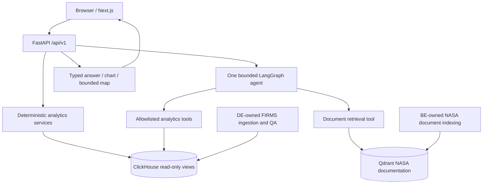

# Technical Design — Indonesia Wildfire Intelligence v1.0

**Status:** Approved under G2 by the Tech Lead on 2026-10-22  
**Approved inputs:** G1 feasibility baseline, D04 data contract v1.0.0, A01 API contract v1.0.0  
**Approval record:** The explicit G2 decision and scope exclusions are recorded in `docs/TASKS.md`.

## 1. Architecture decision

Three development roles (Codex DE, BE, and FE) build the system, but the deployed
application has one bounded LangGraph wildfire-answering agent. There is no runtime
supervisor or autonomous multi-agent hierarchy.

The dashboard's deterministic metadata, summary, and GeoJSON endpoints remain usable
without an LLM. Chat may combine analytics and retrieval, but it may never execute
model-generated SQL or invent values when a dependency is unavailable.

## 2. Frozen v1 baselines

- Observation product: `VNP14IMG.002_SNPP_FIRMS_SP` (NASA FIRMS VIIRS S-NPP
  standard processing, source collection/version `VNP14IMG.002`).
- Supported window: 2023-01-01 through 2023-12-31 inclusive, in UTC.
- Unavailable satellite coverage: 2023-07-26 and 2023-07-27. These dates have null
  totals with coverage evidence; they are never represented as zero detections.
- Province reference: approved OSM-derived 38-province snapshot `2026-10-10b`, pinned
  commit and checksums in the D04 contract, WGS84/OGC:CRS84, with ODbL 1.0 obligations
  and `© OpenStreetMap contributors` attribution.
- Data interface: `data/contracts/hotspot_data_contract_v1.0.0.md` and its schema and
  synthetic fixture.
- Browser interface: `docs/API_CONTRACT.md`, generated OpenAPI snapshot, and shared
  synthetic API fixture, all version `1.0.0`.

Hotspots are satellite active-fire/thermal-anomaly detections. They are not confirmed
wildfire incidents, burned-area estimates, or proof of causation.

## 3. Technology choices

| Area | Technology | v1 rule |
|---|---|---|
| Frontend | Next.js, TypeScript, Tailwind CSS | Browser calls FastAPI only |
| Map | MapLibre GL JS | Bounded WGS84 points; approved tile terms and attribution before release |
| Charts | Recharts | Render only numeric values supplied by the backend |
| Backend | Python 3.12+, FastAPI, Pydantic | OpenAPI snapshot must match implementation |
| Runtime orchestration | LangGraph | One bounded graph with allowlisted tools |
| Model | Configurable server-side provider | Selection requires benchmark/cost review; no browser key |
| Analytical database | ClickHouse | BE uses a read-only serving identity |
| RAG | LangChain components and Qdrant | Official NASA documents with stable citation metadata |
| ETL/geospatial | Polars, GeoPandas, Shapely | Offline normalization and exact point-in-polygon assignment |
| Tests | unittest/pytest, Vitest, Playwright | Contract, deterministic, adversarial, and end-to-end coverage |
| Deployment | Docker Compose on a bounded VPS | Final sizing, TLS, and public activation remain R01 decisions |

## 4. Ownership and trust boundaries

- DE owns NASA acquisition, immutable provenance, normalization, boundary enrichment,
  ClickHouse DDL/migrations, publication, backfill, and data QA. Only DE has ingestion
  credentials and database write access.
- BE owns FastAPI, read-only analytics repositories, NASA-document ingestion/retrieval,
  LangGraph, server-side credentials, quotas, and API error handling. BE receives
  `SELECT` only on D04-published interfaces.
- FE owns the typed API client, dashboard, map/chart/chat presentation, attribution,
  accessibility, and browser tests. FE never accesses ClickHouse, Qdrant, NASA APIs,
  or model credentials directly.
- Shared contracts and architecture documents are versioned and require coordinated
  review. Approved versions are immutable; breaking changes require a new version.
- Synthetic fixtures stay explicitly labeled and cannot be used as NASA observations,
  correctness evidence, or evaluation results.

## 5. DE-to-BE data interface

D04 freezes logical interfaces, while D06 will choose physical engines, partitions,
ordering keys, materialization, and grants. The serving identity sees only:

| Interface | Purpose |
|---|---|
| `analytics_hotspot_observations_v1` | Exact-deduplicated observations and bounded point retrieval |
| `analytics_daily_coverage_v1` | Daily present/gap/verified-zero/unknown coverage semantics |
| `analytics_provinces_v1` | Canonical province filters and boundary provenance/attribution |
| `analytics_ingestion_batches_v1` | Published immutable batch provenance and freshness |

Province assignment is performed offline against the approved polygon snapshot.
Exactly one polygon match is assigned; zero or multiple matches retain null province
fields. BE does not receive boundary geometry and must not coerce unassigned points.

All aggregates left-join requested dates to daily coverage. A partially covered range
may return an available subtotal only with `is_complete=false`, exact coverage issues,
and a warning. A wholly unavailable range returns a null total. A complete and
independently verified zero range may return zero.

Map queries use stable `(acquired_at_utc, observation_id)` ordering, default to 500,
cap at 5,000, fetch at most `effective_limit + 1`, and expose only the D04/A01 property
allowlist. Raw row hashes, source row numbers, batch internals, and polygons never
reach the browser.

## 6. Runtime and request flow

1. FastAPI validates payload size, message length, product, province, UTC dates,
   maximum range, map limit, and typed request structure.
2. Deterministic endpoints call parameterized repository methods. Repositories build
   allowlisted read-only queries; callers and models never provide SQL text.
3. Chat routes a request to analytics, NASA-document retrieval, both, or an unsupported
   response. Tool calls, graph steps, tokens, concurrency, and wall-clock time are
   bounded server-side.
4. Retrieval returns official-source passages with stable URLs and chunk IDs.
   Retrieved content is treated as untrusted data, never as executable instructions.
5. The composer emits an A01-valid response. Numeric metrics and chart/map values must
   exactly match tool outputs, and citations must refer to retrieved source metadata.
6. Missing evidence, gaps, unsupported metrics, dependency failures, causal requests,
   and burned-area requests produce explicit limitations or abstention.

The v1 API is non-streaming JSON. Adding SSE or another transport is a later contract
change, not an implementation detail.

## 7. Browser API and compatibility

The approved base path is `/api/v1`. A01 defines health, metadata, summary, bounded
GeoJSON, chat, typed errors, request IDs, coverage/source fields, and compatibility.
Every response carries a request ID; verified analytics carry product, coverage,
freshness, provenance, and hotspot caveats. The browser distinguishes complete zero,
empty, partial, wholly unavailable, truncated, invalid, rate-limited, timed-out, and
dependency-unavailable states.

Backend OpenAPI generation and the committed snapshot must match. FE types and shared
fixtures are contract consumers, not independent sources of truth. Additive compatible
changes require coordinated tests; type, nullability, enum, meaning, or endpoint
changes require a new contract version and Tech Lead approval.

## 8. Security and resource budgets

- Secrets remain server-side and never use browser-exposed `NEXT_PUBLIC_*` variables.
- ClickHouse serving access is parameterized and read-only; unrestricted generated SQL
  is prohibited. D06 and I01 must prove write denial and version compatibility.
- B05 owns per-client/global quotas, concurrency limits, payload caps, tool/model
  budgets, retry caps, timeouts, CORS allowlists, and safe 429/504 behavior.
- Logs redact secrets and sensitive content. Avoid raw IP retention where feasible.
- Document ingestion records source URLs and hashes, rejects unsafe formats, and treats
  prompt-like content as data.
- Containers should run non-root where feasible and use health checks, resource caps,
  dependency scanning, and separate service credentials.
- Provider spending controls supplement but do not replace application-side limits.

## 9. Observability and evaluation

Structured logs include request ID, route, tool type, duration, result size, dependency
status, graph/tool counts, token use, and estimated cost where available. Sensitive
messages, credentials, SQL details, and stack traces are not returned to clients.

Q01 measures deterministic analytical accuracy, retrieval Recall@5, citation support,
unsupported-request handling, prompt injection resistance, accessibility, end-to-end
behavior, limits, and performance. Proposed PRD targets are not observed results and
must be published with failures after a reproducible run.

## 10. Delivery sequence

1. After G2 approval, D05 ingestion and B02 analytics implementation may start in
   parallel against immutable D04/A01 contracts.
2. D06 materializes the ClickHouse model/views after D05; B04 follows B02 and B03.
3. I01 proves DE/BE parity and read-only access; I02 replaces UI mocks only after I01
   and B04.
4. D07 and B05 complete operating controls; Q01 evaluates the integrated system.
5. R01 performs deployment rehearsal and requires a separate release approval before
   public activation.

No ticket may treat approved architecture as evidence that its implementation or tests
already exist.

## 11. Deferred decisions with owners

These choices do not change the approved shared interfaces and therefore do not block
G2. Their owners must resolve and evidence them before the named downstream gate:

| Decision | Owner/ticket | Latest required point |
|---|---|---|
| ClickHouse engines, partitions, ordering, materialization | DE / D06 | Before D06 review |
| Model and embedding provider/version | BE / B04–B05, Lead approval if paid | Before live B04/Q01 run |
| Qdrant local versus hosted | BE / B03–B05, Lead | Before R01 |
| Production map tiles and terms | FE / I02, Lead | Before Q01/R01 |
| Public authentication, quotas, spend ceiling | BE / B05, Lead | Before Q01/R01 |
| VPS sizing, TLS, monitoring, backup, rollback | Lead / R01 | Before release approval |

The product/window, province geometry, API/data versions, non-streaming v1 transport,
single-agent topology, and role/security boundaries are not deferred decisions.
