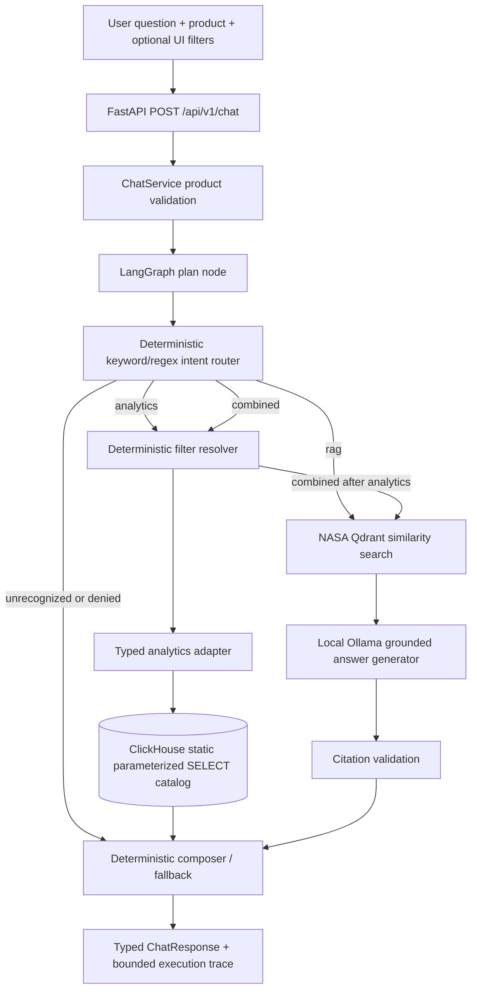
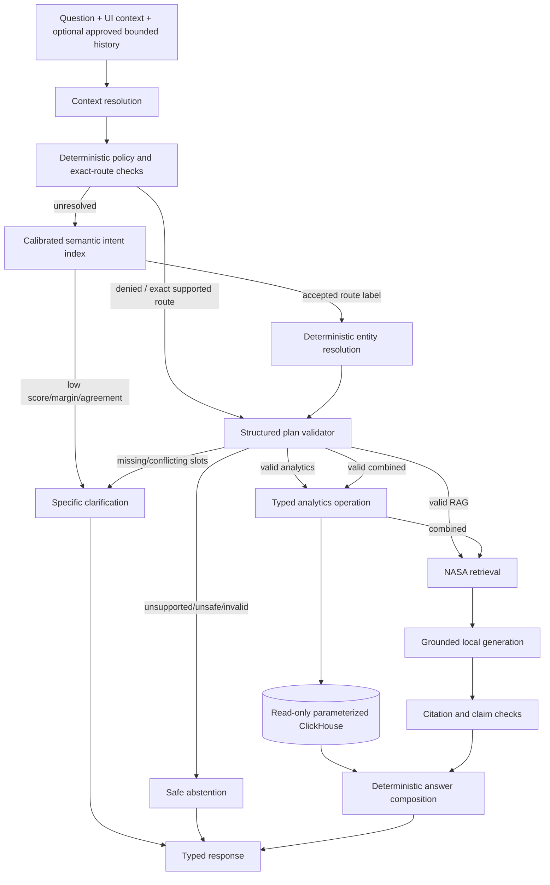
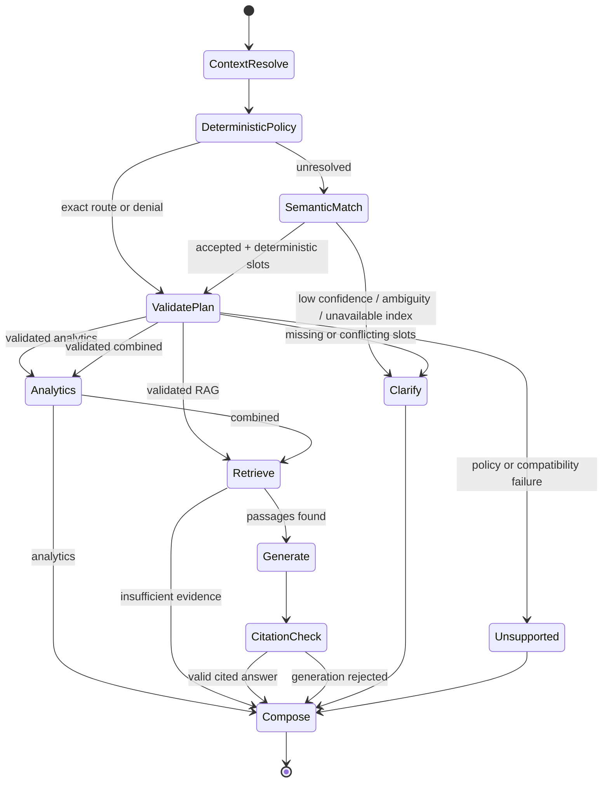
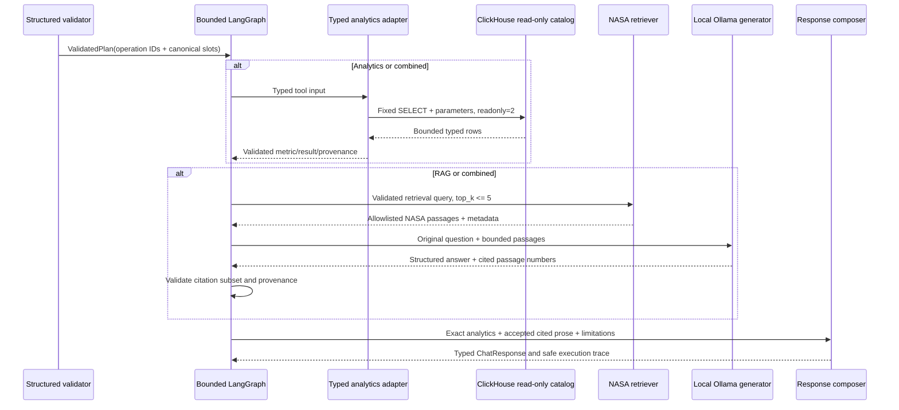

# Semantic-Only Intent Routing Technical Design

**Status:** LIR-09 implementation in review; guarded by default with deterministic rollback  
**Decision scope:** Chatbot intent understanding and routing only  
**Architecture constraint:** One bounded LangGraph runtime with deterministic, typed tools

## 1. Design summary

After deterministic security policy and high-precision routes, classify unresolved wording with a versioned multilingual intent-example index. Score, runner-up margin, and neighbor agreement must meet measured per-intent thresholds. A server-owned resolver and LIR-04 validator independently derive and validate every executable field. Neither an embedding score nor a generative LLM authorizes analytics.

The semantic intent index remains separate from NASA RAG and contains reviewed labels/examples, never production chats or SQL. Low-confidence, low-margin, low-agreement, incompatible, or missing-slot results clarify. Deterministic denials remain authoritative. The existing NASA answer generator is unchanged; analytics-only deterministic formatting still uses zero LLM calls.

This design reuses FastAPI, Pydantic, Ollama, LangGraph, Qdrant, the deterministic router, filter resolver, typed analytics adapters, ClickHouse query catalog, NASA RAG index, citation validation, and execution budgets. It introduces no new runtime agent, service, framework, arbitrary SQL path, or database schema.

## 2. Current architecture



Current limitations:

- The LLM is invoked after RAG retrieval, not before routing.
- Rule coverage is wording-sensitive and requires code changes for new patterns.
- B14 semantic fallback is disabled after failing held-out accuracy/fallback gates.
- The request carries no conversation history, so the backend cannot safely resolve “What about Aceh?” from an earlier turn.
- Current intent and filter logic are split across router, resolver, and runtime regexes, which makes complete operation validation harder to reason about.
- The repository has a deterministic bounded GeoJSON endpoint and a trace operation vocabulary for maps, but the current chat runtime has no typed map tool adapter; the proposed planner must not advertise map execution as an available chat operation.
- Qdrant NASA retrieval is dense-only with fixed character chunking and no reviewed MRR/nDCG baseline.

## 3. Proposed architecture



### 3.1 Context resolution

Inputs are the original question, approved UI context, and—only after a contract is approved—a bounded list of prior user/assistant turns. Context resolution performs deterministic normalization, detects explicit current-turn entities, and constructs an internal `ResolvedConversationContext` containing only canonical candidates and provenance.

Precedence:

1. Valid explicit current-turn values.
2. Valid UI context for missing current-turn fields.
3. Valid prior user-turn context for a recognized follow-up, if the contract supplies it.
4. Never use prior assistant prose as numeric evidence or executable parameters.

History should be capped by turns, per-turn characters, total characters, and age within the request. The recommended initial bound is four prior turns and 4,000 total history characters, subject to contract review and measured token usage. The backend stores no implicit session memory.

### 3.2 High-precision deterministic routing

The deterministic layer remains authoritative for:

- Prompt/tool/SQL injection and requests to expose secrets or internal instructions.
- Unsupported measures, products, regions, dates, prediction, and causal claims.
- Existing exact routes whose reviewed patterns are unambiguous.
- Quoted or negated clauses that must not become executable intent.

It emits either a final safe policy decision or `needs_semantic_routing`. A prohibited request never reaches a probabilistic route that could later authorize a tool.

### 3.3 Semantic intent classification

Use the separate versioned intent-example index with a pinned local multilingual embedding model. Each reviewed example contains only text, language, intent, slot shape, and review metadata. Search returns a bounded top-K; candidates are grouped by intent and accepted only when score, runner-up margin, and neighbor agreement meet the committed per-intent calibration.

The match result is a strict internal value:

```python
class SemanticIntentMatch(BaseModel):
    intent: SemanticIntent | None
    accepted: bool
    score: float | None
    margin: float | None
    agreement: float | None
    reason: Literal["accepted", "low_score", "low_margin", "low_agreement", "no_candidates"]
```

It contains no SQL, entity values, numeric answer, citation, rewrite, prompt, or chain-of-thought. Clarification is represented by rejection; unsupported remains an authoritative deterministic policy result. Routing/planning performs zero generative LLM calls.

### 3.4 Query rewriting

Rewriting is not a separate autonomous step. A deterministic context resolver may produce one bounded internal standalone representation after an approved history contract. The validator requires:

- All provinces, dates, product, metric, direction, comparison scope, and negation to be traceable to approved input context.
- No added facts, filters, causal claims, or unsupported measurements.
- The current turn to override history.
- The original question and resolved typed entities to remain the audit source of truth.

Analytics never executes from rewritten prose. It executes from independently canonicalized slots. If equivalence cannot be established, the system clarifies.

### 3.5 Deterministic execution gate

Similarity selects only a coarse intent/route. `ChatFilterResolver` extracts provinces and absolute dates from the request/UI context. `SemanticExecutionGate` maps only compatible reviewed intents to fixed operation IDs, builds the strict LIR-04 `IntentPlan`, and requires `IntentPlanValidator` to produce a `ValidatedPlan`. Analytics adapters consume validated arguments. Missing slots, map intent without an approved chat adapter, catalog drift, or incompatible operations clarify with zero ClickHouse calls.

### 3.6 Structured plan validation

`IntentPlanValidator` is a deterministic service and the only boundary allowed to turn a proposed plan into an executable `ValidatedPlan`. It checks:

- Route and operation allowlists.
- Deterministic denial agreement.
- Entity provenance in current message, UI context, or approved user history.
- Canonical province aliases and distinct comparison/ranking scope.
- Exact product, metric, coverage window, absolute dates, direction, and top-N bounds.
- Required/forbidden slot combinations for each operation.
- Combined-route independence: at least one valid analytics operation and one valid NASA documentation request.
- Retrieval query equivalence and length.
- Tool/model/graph budgets.

Any disagreement becomes a specific clarification or unsupported result. There is no arbitrary “best effort” coercion.

### 3.7 Tool registry

Create one internal read-only registry that describes each existing operation without changing ClickHouse SQL:

| Operation ID | Route | Required slots | Execution boundary |
|---|---|---|---|
| `hotspot_summary_v1` | analytics | one province, product, absolute dates | Existing monthly-count summary adapter |
| `hotspot_trend_v1` | analytics | province scope, product, absolute dates | Existing monthly series |
| `hotspot_multi_province_summary_v1` | analytics | 2-38 provinces, product, dates | Existing B13 typed province analytics |
| `hotspot_province_ranking_v1` | analytics | product, dates, direction/selection | Existing B13 all-38 ranking |
| `nasa_documentation_v1` | rag | supported NASA topic | Existing Qdrant retrieval plus local grounded generation |

The registry contains semantic descriptions and slot rules, never SQL. Data Engineer-owned canonical metric/entity definitions feed the registry; Backend owns runtime mapping.
The existing `GET /hotspots/geojson` endpoint remains outside the chat planner until a separate ticket adds and approves a typed chat map adapter.

## 4. Proposed LangGraph routing and recovery



The graph remains a single agent. Semantic matching and validation are bounded services, not agents. There is one embedding lookup and no generative planning call or retry.

Recovery order:

1. Preserve deterministic exact decisions when valid.
2. If the semantic index is unavailable or a match is rejected, return a reason-specific clarification/fallback.
3. Never promote an unaccepted semantic match to execution.
4. If analytics succeeds but RAG fails in a combined request, return the exact analytics result with an explicit documentation limitation and `partial` trace status where the approved contract supports it.
5. If evidence is insufficient or citations fail, omit generated documentation claims and abstain; never improvise.

## 5. Tool execution flow



## 6. NASA retrieval optimization

Retrieval work is independent of intent routing and must be measured separately:

1. Freeze the current all-minilm dense baseline and reviewed relevance judgments.
2. Measure Recall@K, MRR, nDCG@K, source diversity, and latency.
3. Test structure-aware chunks that preserve headings/definitions against the current 1,400-character/200-overlap chunks.
4. Test metadata filters only from validated server fields such as document/product/version/language.
5. Test BM25 plus dense candidates with deterministic reciprocal-rank fusion; do not combine incomparable raw scores.
6. Test a bounded local reranker only after hybrid retrieval demonstrates remaining ranking errors worth its resource cost.
7. Adopt only improvements that preserve provenance, citation support, startup compatibility, rollback, and resource limits.

NASA retrieval changes remain independent of semantic intent routing.

## 7. Error handling

| Failure | Required behavior |
|---|---|
| Deterministic denial | Unsupported response; zero model/tool calls where practical and zero forbidden tool calls. |
| Missing/ambiguous entities | Specific clarification; no analytics query. |
| Embedding service unavailable/timeout | Deterministic exact route if already known; otherwise safe clarification/fallback. No provider switch. |
| Invalid semantic execution plan | Reject all fields; clarify/fallback. No partial execution. |
| Semantic index absent/incompatible | Use the disabled deterministic baseline according to the feature flag. |
| ClickHouse unavailable/invalid result | Existing typed dependency error/limitation; do not let the LLM invent a number. |
| RAG returns no relevant evidence | Abstain from documentation claim; retain independently valid analytics if combined. |
| Citation/model validation fails | Reject generated prose and cite nothing unsupported. |
| History conflicts with current turn | Current valid turn wins; otherwise clarify. |
| Budget exceeded | Existing bounded timeout/dependency behavior with no retry loop. |

## 8. Performance and local inference

- Benchmark embedding routing independently from RAG generation; routing adds zero generative model calls.
- Cache only version-compatible reviewed example embeddings; do not persist production questions as examples.
- Record p50/p95 embedding search, retrieval, reranking, generation, and end-to-end latency; generation tokens/calls; peak RSS; CPU; and index size.
- Batch offline embeddings and version cache/index keys by model revision, preprocessing, catalog version, and schema version.
- Keep planning and generation within the existing request timeout or propose an explicit bounded budget change with measurements. Do not hide timeouts through unbounded retries.

## 9. Feature flags and rollback

Recommended internal configuration:

| Flag | Values | Purpose |
|---|---|---|
| `semantic_routing_mode` | `disabled`, `shadow`, `guarded` | Controls whether matches are ignored, measured, or allowed after LIR-04 validation. LIR-09 makes `guarded` the accepted default; `disabled` is the one-setting deterministic rollback. |
| `history_resolution_enabled` | boolean | Remains false until an approved request contract and FE support exist. |
| `rag_retrieval_profile` | versioned profile ID | Selects an evaluated dense/hybrid/reranked collection/profile. |

Rollout:

1. `disabled`: deterministic rollback behavior.
2. `shadow`: produce and validate plans, emit aggregate metrics, never change user-visible route or tool calls.
3. Offline gate review using frozen holdout and shadow evidence.
4. `guarded` (default): semantic routing affects only deterministic `unrecognized` cases and only after validation.
5. Expand eligible intents only after per-intent gates pass.

Rollback sets `semantic_routing_mode=disabled` and returns immediately to the existing deterministic path. Index/model rollback selects a previously compatible pinned profile; startup never silently rebuilds or mixes indexes.

## 10. Contract and ownership decisions

- Backend Engineer owns intent examples/index compatibility, embedding integration, validators, LangGraph nodes, RAG, feature flags, backend evaluation, and runtime tests.
- Data Engineer owns canonical metrics, units, aliases, product/coverage/geography semantics, supported operations, null/zero/tie rules, and independent numeric truth fixtures.
- Frontend participates only if an optional history request or new public clarification/trace field is approved.
- Tech Lead approves shared contract changes, model/profile selection, thresholds, guarded rollout, and Q01 disposition.

No public contract change is necessary for current-turn semantic routing. True multi-turn resolution is blocked until a coordinated optional history contract is reviewed. The system must not substitute hidden server sessions.

## 11. Requirements-to-components traceability

| Requirements | Design components |
|---|---|
| FR-01, FR-06, FR-12 | Deterministic policy, structured validator, LangGraph recovery |
| FR-02, FR-03, FR-04 | Calibrated semantic match, strict `IntentPlan`, bounded rewrite |
| FR-05, FR-07 | Entity canonicalization, tool registry, typed ClickHouse adapters |
| FR-08, FR-09 | NASA retriever, citation checks, combined execution |
| FR-10, FR-11, FR-13 | Context resolver and separate history contract gate |
| FR-14, FR-15 | Feature flags, shadow telemetry, rollback |
| FR-16 | Candidate-strategy ablation and explicit no-adoption option |
| NFR-01 through NFR-10 | Bounded graph, local inference, compatibility, fail-closed behavior, reproducibility |

## 12. Decisions requiring approval

1. Approve the deterministic-first/local-LLM/validator architecture before implementation.
2. Decide whether true follow-up handling warrants an additive optional history request contract; otherwise defer it.
3. Approve the first planning model only after comparative local evaluation; the existing Qwen model is a baseline, not a preselected winner.
4. Confirm semantic candidate retrieval remains optional and may close with a documented no-adoption result.
5. Approve quantitative rollout gates and the eligible-intent sequence.
6. Decide whether one structured-output repair call is worth evaluating after the no-retry baseline.
