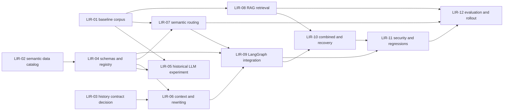

# Semantic Intent Routing Implementation Tickets

**Status:** LIR-01 through LIR-04 and LIR-08 through LIR-11 are approved `DONE`; LIR-05 through LIR-07 are `IN_REVIEW`; LIR-12 remains proposed  
**Canonical lifecycle:** `docs/TASKS.md`  
**Total tickets:** 12

All tickets preserve the single bounded LangGraph runtime, the approved API/data contracts until separately changed, deterministic security policy, typed read-only ClickHouse access, and NASA citation provenance. Implementation agents stop at `IN_REVIEW`; only the Tech Lead records `DONE` or approves shared contracts and rollout.

## Dependency graph and recommended order

LIR-05 is retained as historical evidence but is not a production dependency after the approved semantic-only architecture decision. LIR-06 depends on the history decision and LIR-04 contracts. LIR-07 consumes LIR-01, LIR-02, and LIR-04. The explicit 2026-11-17 Tech Lead decision permits LIR-09 integration despite LIR-07's failed quality gates; LIR-12 remains the final release decision.

## Phase 1 — Current-system audit and benchmark

### LIR-01 — Freeze the current-system audit, corpus, and baseline

- **Objective:** Convert the verified B10-B14/Q01 behavior into a versioned, independently reviewable baseline and create the family-separated English/Indonesian evaluation corpus defined in `EVALUATION.md`.
- **Priority:** P0
- **Owner / responsible agent:** Backend Engineer; Data Engineer reviews structured truth; Tech Lead approves the freeze.
- **Dependencies:** None. Consume existing approved contracts and B11/B14 reports; do not relabel consumed holdouts as new test data.
- **Files or modules affected:** `backend/evaluation/`, `backend/tests/evaluation/`, `backend/reports/`, optional reviewed `data/contracts/` truth fixtures, and this feature's result documentation. No runtime behavior.
- **Implementation scope:** Inventory current routes, operations, filters, tool/model calls, B14 semantic profiles, RAG relevance labels, and known failures; define the new corpus schema; author/review at least 800 cases with semantic-family splits; implement leakage/duplicate validation and A/B/C/D-compatible runner interfaces; execute and record variant A and current variant B baselines.
- **Out of scope:** Changing routing, prompts, thresholds, models, indexes, application configuration, or expected labels to improve scores.
- **Acceptance criteria:** Corpus composition/language/intent minima pass; every case has route, operation, entity, reason, and call-boundary labels; DE truth cases are independently reproducible; train/dev/shadow/final partitions have no exact/template leakage; baseline commands and actual results are immutable and machine-readable.
- **Testing and verification:** Corpus-schema tests, uniqueness/near-duplicate checks, split-family checks, label-vocabulary validation, deterministic repeatability, reference-query fixture reconciliation, and rerun of current B11/B14/Q01 regressions.
- **Deliverables:** Versioned corpus and manifest, baseline runner, A/B result artifacts, audit report with limitations and unmeasured fields.
- **Implementation evidence (2026-11-15):** `backend/evaluation/lir01_intent_routing_corpus_v1.json` and its manifest freeze 1,200 synthetic cases in 300 semantic families with 451 English, 449 Indonesian, and 300 mixed-language questions; all category/language and final-intent minima pass. The sealed final holdout has 400 cases and was not consumed. The final corpus SHA-256 is `148118c06de8cb9e007bc1767d1fc84a900c56d8cb90c9644fdb91da50ed8102`. Strict schema, generator, duplicate/template leakage, truth-source/crosswalk, edge-semantics, holdout-seal, repeatability, and immutability checks live in `backend/tests/evaluation/test_lir01_baseline.py`. The independently reviewed DE boundary covers product, metric, canonical geography, date/coverage, verified-zero, tie, null-geography, and truth provenance; its final review has no data-owned blocker. `backend/evaluation/lir01_variant_a_baseline_v1.json` and `lir01_variant_b_baseline_v1.json` record 800 development plus shadow cases only. A/B route accuracy is 33.50%/35.50%, entity exactness 8.54%/11.67%, supported fallback 68.83%/64.33%, unsupported false accepts 0/0, and forbidden calls 0/0. The full backend suite passed 389 with 1 existing opt-in skip; repository-wide Ruff passed; all four LIR-01 Python files pass Ruff formatting. `backend/reports/LIR01_BASELINE_AND_CORPUS_REVIEW.md` records commands, profiles, limitations, underpowered language-intent cells, and unmeasured fields. No chatbot runtime behavior, configuration, dependency, model, index, prompt, threshold, API, or ClickHouse code changed.
- **Review limitation:** The approved DE crosswalk uses `91=Papua` and `92=Papua Barat`, while the pre-existing Backend resolver uses a different Papua code convention. LIR-01 correctly freezes this as a measured runtime mismatch and does not change runtime behavior. Multi-turn accuracy is 0% because the current API has no approved history contract. LIR-01 makes no numeric-answer, NASA retrieval, citation, faithfulness, production-capacity, rollout, or release claim.
- **Status:** DONE

### LIR-02 — Publish the structured analytics semantic catalog

- **Objective:** Give Backend a versioned, machine-readable source of canonical metric, product, geography, coverage, and operation semantics without moving data ownership into LLM code.
- **Priority:** P0
- **Owner / responsible agent:** Data Engineer; Backend Engineer is the consumer reviewer.
- **Dependencies:** Existing D04/A03 data contracts and B13 behavior.
- **Files or modules affected:** `data/contracts/`, `data/tests/`, and DE handoff documentation. Backend is not modified by this ticket.
- **Implementation scope:** Define stable metric IDs, English/Indonesian labels and aliases, unit/grain, valid dimensions/operations, required slots, product compatibility, date coverage, province aliases/codes, null/zero/unavailable semantics, ranking/tie/exclusion rules, unsupported interpretations, safe retrieval-filter fields, and positive/negative truth fixtures.
- **Out of scope:** Embedding models, prompts, routing, query rewriting, RAG, LangGraph, backend implementation, or new metrics/views.
- **Acceptance criteria:** All currently supported analytics operations map to one canonical metric/data contract; aliases are unique or explicitly ambiguous; every semantic rule has a positive and negative fixture; independent reference queries reproduce numeric truth including zero, tie, partial, unavailable, and unassigned-geography cases.
- **Testing and verification:** Schema validation, alias collision tests, coverage/product compatibility checks, fixture/reference-query reconciliation, version/breaking-change tests, secret scan.
- **Deliverables:** Versioned semantic catalog, fixtures, reference queries/results, migration/BE handoff notes.
- **Implementation evidence (2026-11-15):** Published `hotspot_semantic_catalog_v1.0.0` with a strict schema, deterministic generator, 38-province bilingual crosswalk, four current analytics operations, safe filter cardinalities, and explicit product/coverage/ranking/null semantics. Eight semantic rules each have one positive and one negative fixture; five independently derived synthetic edge results cover ties, covered zero, partial coverage, wholly unavailable null, and geography exclusion. Separate verified snapshot evidence reconciles 253,388 observations, 252,582 assigned, 796 unassigned, 10 multiple matches, 806 exact-one-province exclusions, and 687 Riau September detections. Parameterized read-only reference SQL uses only published views. The focused suite passed 10 tests; the full data suite passed 71 tests in 71.40s; LIR-02 Ruff lint/format and dependency integrity passed. No Backend or runtime behavior changed.
- **Review limitation:** The catalog correctly follows the approved DE Papua code mapping, which differs from the existing Backend resolver. Backend must reconcile this known consumer mismatch before catalog adoption. Repository-wide `ruff check data` still reports 40 pre-existing findings outside LIR-02 files; all changed Python files pass.
- **Status:** DONE

### LIR-03 — Decide and, if approved, specify bounded conversation history

- **Objective:** Resolve the only public-contract blocker for true follow-up understanding while preserving old clients and avoiding hidden server memory.
- **Priority:** P0 for decision; implementation is conditional.
- **Owner / responsible agent:** Tech Lead with Backend and Frontend Engineers; privacy/security review required.
- **Dependencies:** Approved API v1.2.0 baseline and current FE client validation behavior.
- **Files or modules affected:** If approved, `docs/API_CONTRACT.md`, versioned OpenAPI proposal/snapshot, shared synthetic fixtures, backend/frontend contract validators/tests. If deferred, only the decision record.
- **Implementation scope:** Compare an optional bounded request `history` field with deferral; define role allowlist, turn/character limits, ordering, current-turn precedence, privacy/logging, error behavior, old-client compatibility, FE-reader-before-BE-writer rollout, and rollback. Record an explicit approve/defer/reject decision.
- **Out of scope:** Server-side sessions, persistent memory, chat storage, model summaries as authority, unbounded transcripts, runtime context resolver, or silent public-contract changes.
- **Acceptance criteria:** A signed decision exists. If approved, the additive contract is strict, bounded, backwards-compatible, represented in synthetic fixtures/OpenAPI, and has matching BE/FE consumer tests. If deferred, LIR-06 explicitly limits itself to current message plus UI context and multi-turn acceptance cases remain gated.
- **Testing and verification:** Contract schema/unknown-field/boundary tests; old-client compatibility; oversized/malformed history rejection; no raw history in response/trace/log fixtures; FE-reader/BE-writer deployment simulation.
- **Deliverables:** Decision record and, only if approved, versioned contract proposal plus rollout/rollback plan.
- **Decision evidence (2026-11-15):** `LIR03_HISTORY_DECISION.md` defers public history support. True follow-ups require explicit history, but the current scope remains current-message plus validated UI context. Bounded client-supplied history is the recommended future design; server-managed memory is rejected. Multi-turn acceptance remains gated and `history_resolution_enabled` remains false. No public contract or runtime changed.
- **Status:** DONE

## Phase 2 — Historical structured-planner work and bounded context

### LIR-04 — Implement strict planning schemas and the typed operation registry

- **Objective:** Establish a deterministic boundary between natural-language proposals and executable existing tools.
- **Priority:** P0
- **Owner / responsible agent:** Backend Engineer; Data Engineer reviews semantic catalog consumption.
- **Dependencies:** LIR-02 `DONE`; approved existing API/data contracts.
- **Files or modules affected:** New or existing modules under `backend/src/wildfire_api/agent/`, backend configuration if internal-only, and unit tests. The ClickHouse query catalog is consumed, not rewritten.
- **Implementation scope:** Add strict bounded `IntentPlan`, entity/provenance, clarification, operation-definition, and `ValidatedPlan` models; build a read-only registry for existing chat summary/trend/multi-province/ranking/NASA operations; map the LIR-02 catalog into server-owned descriptions and slot rules; implement cross-field validation and explicit rejection codes. Do not register the separate GeoJSON endpoint as a chat tool.
- **Out of scope:** Calling a model, routing user requests, executing tools, new SQL/operations, public trace fields, or exposing planner output.
- **Acceptance criteria:** Extra/unknown fields fail; every accepted operation maps one-to-one to an existing typed adapter; schemas contain no SQL/table/arbitrary tool/answer/chain-of-thought field; every required and incompatible slot combination has a test; catalog version incompatibility fails closed.
- **Testing and verification:** Pydantic property/boundary tests; operation/adapter completeness; invalid enum/length/slot/provenance cases; semantic-catalog compatibility; secret/forbidden-field scan.
- **Deliverables:** Planning/validated schemas, operation registry, validator skeleton, unit tests, schema/registry review report.
- **Implementation evidence (2026-11-15):** Added strict frozen `IntentPlan`, entity/provenance, clarification, operation-argument, and `ValidatedPlan` schemas; a read-only registry for the five allowlisted existing operations; and a fail-closed validator backed by `hotspot-semantic-catalog-v1.0.0`. Catalog/schema/data-contract drift, extra fields, unknown operations, invalid metrics/products/provinces/dates/dimensions/operators, incompatible slots, duplicate entities, adversarial execution fields, and deterministic denials are rejected explicitly. The focused suite passed 25 tests; the full backend suite passed 414 with one existing opt-in ClickHouse skip; changed-file Ruff lint/format and secret scan passed. `backend/reports/LIR04_SCHEMA_REGISTRY_REVIEW.md` records the boundary. No runtime, LangGraph, model, SQL, dependency, or public API changed.
- **Review limitation:** Existing Backend province resolution still uses a Papua-code convention different from the approved LIR-02 catalog. LIR-04 consumes the approved catalog and does not modify runtime resolution.
- **Status:** DONE

### LIR-05 — Add the local structured intent planner

- **Objective:** Use a pinned loopback Ollama model to classify unresolved language into the LIR-04 schema without answering the question or authorizing execution.
- **Priority:** P0
- **Owner / responsible agent:** Backend Engineer.
- **Dependencies:** LIR-01 and LIR-04 `DONE`.
- **Files or modules affected:** `backend/src/wildfire_api/llm/`, `backend/src/wildfire_api/agent/`, `backend/core/config.py`, `.env.example`, planner unit/integration tests, evaluation adapters, and a backend report.
- **Implementation scope:** Extend/reuse the Ollama client for JSON-schema planning; construct concise system/user payloads from the original question, canonical UI context, static operation catalog, and semantic rules; enforce temperature zero, token/timeout limits, one call/no retry initially, loopback-only endpoint, strict parsing, and reason-specific failure. Benchmark the existing Qwen model first and pin any selected local alternative with license/digest/resource evidence.
- **Out of scope:** Tool execution, SQL generation, free-form answers, cloud fallback, browser model access, history until LIR-03/LIR-06, or adopting a new model without comparative approval.
- **Acceptance criteria:** Valid fixture responses parse deterministically; malformed/extra/unknown-operation output fails closed; prompts contain no credentials/SQL and planner logs contain no raw question/prompt/output; model unavailability never selects a tool; measured development results and latency/resource data are reported, not inferred.
- **Testing and verification:** Transport/schema tests, timeouts, malformed JSON, oversized fields, injection-shaped output, unknown operations, deterministic repeat calls, loopback enforcement, full existing Ollama/RAG regressions, local opt-in model benchmark.
- **Deliverables:** Structured planner adapter, prompt/schema version, configuration flags defaulting disabled, tests, measured model comparison/recommendation.
- **Implementation evidence (2026-11-16):** Added an isolated one-call loopback Ollama planner pinned to `qwen2.5:1.5b`, prompt `lir05-intent-planner-v1`, temperature zero, bounded timeout/tokens, strict LIR-04 parsing/validation, privacy-safe outcome logging, and disabled-by-default settings. Added a LIR-01 development evaluator and an actual fail-closed availability probe. The focused mocked suite passed 12 tests; the full backend suite passed 426 with one existing opt-in ClickHouse skip; Backend Ruff and changed-file formatting passed. No LangGraph/runtime integration, tool execution, public API, dependency, or query behavior changed.
- **Review limitation:** Ollama is not installed and no loopback service is available, so the required 480-case development benchmark, model digest/license verification, and live latency/resource comparison remain blocked. The recorded one-case probe returned `model_unavailable` safely in 32.50 ms. No rollout or quality claim is made.
- **Status:** IN_REVIEW
- **Architecture disposition (2026-11-17):** Retained as immutable experimental evidence only. Generative routing/planning is superseded by semantic-only routing and is not a dependency of the production path. Historical benchmark artifacts must not be deleted.

### LIR-06 — Implement context resolution and semantics-preserving rewriting

- **Objective:** Resolve current-turn/UI context and, if LIR-03 approves it, bounded follow-up context without inventing or silently changing meaning.
- **Priority:** P0
- **Owner / responsible agent:** Backend Engineer; Frontend participates only for an approved history contract.
- **Dependencies:** LIR-03 decision and LIR-04 `DONE`; LIR-05 is not a dependency under the semantic-only architecture.
- **Files or modules affected:** `backend/src/wildfire_api/agent/filter_resolver.py`, new context/rewrite modules, chat schemas only if LIR-03 approved them, backend tests, and matching FE contract code only under the approved contract ticket.
- **Implementation scope:** Preserve original input; apply current-message > UI > approved user-history precedence; identify follow-up frames; canonicalize entity provenance; validate an optional NASA retrieval query/standalone follow-up representation for semantic preservation; reject conflicts, unsupported carry-over, assistant-derived numeric facts, and unsafe history.
- **Out of scope:** Persistent sessions, cross-request memory, auto-learning, using rewrites for ClickHouse parameters, relative dates beyond approved semantics, or frontend work when history is deferred.
- **Acceptance criteria:** All current B10 precedence tests pass; current-turn overrides are exact; approved follow-ups resolve only allowed missing context; topic shifts and conflicts clarify; no executable entity originates solely from assistant prose; analytics always consumes canonical typed slots, not rewritten text.
- **Testing and verification:** Bilingual single/multi-turn minimal pairs; carry-over/override/conflict/negation tests; malicious/oversized history; rewritten-query preservation review; property tests ensuring no new canonical entity appears; API compatibility tests if applicable.
- **Deliverables:** Context resolver/rewrite validator, tests, privacy and contract evidence, limitations report.
- **Implementation evidence (2026-11-16):** Added bounded current-message/UI context resolution, bilingual follow-up/reference detection, canonical planner-entity provenance validation, and conservative NASA retrieval-query preservation checks. Current-message values override UI exactly; stale UI, invented operators/entities, added/dropped filters, changed negation/measurement, topic shifts, hidden-history provenance, and oversized inputs fail closed. Province-universe ranking remains valid without inventing a selected province. The LIR-06 suite passed 24 tests; the full backend passed 450 with one existing opt-in ClickHouse skip; Backend Ruff and formatting passed. `backend/reports/LIR06_CONTEXT_REWRITE_REVIEW.md` records privacy and contract evidence. No runtime or public API changed.
- **Review limitation:** LIR-03 deferred history, so true multi-turn carry-over remains gated and ambiguous follow-ups clarify. LIR-05 is no longer a dependency under the 2026-11-17 semantic-only decision; the existing Papua-code mismatch remains an integration risk.
- **Status:** IN_REVIEW

## Phase 3 — Semantic and RAG retrieval improvements

### LIR-07 — Implement and evaluate guarded semantic-only routing

- **Objective:** Replace generative intent routing with calibrated multilingual intent-example similarity while retaining deterministic policy, extraction, and LIR-04 authorization.
- **Priority:** P0; rollout remains gated by measured quality.
- **Owner / responsible agent:** Backend Engineer.
- **Dependencies:** LIR-01, LIR-02, and LIR-04 `DONE`. LIR-05 is explicitly not a dependency.
- **Files or modules affected:** Semantic intent resources/index, semantic planner/execution gate, bounded LangGraph runtime wiring, evaluation runner/artifacts, focused tests, and these design records.
- **Implementation scope:** Keep deterministic denials/exact routes authoritative; classify only unresolved questions using reviewed multilingual examples and calibrated score/margin/agreement thresholds; represent low-confidence results as clarification; support analytics, NASA RAG, combined, clarification, and unsupported routes; require deterministic filters and LIR-04 `ValidatedPlan` before analytics; preserve existing NASA generation and deterministic analytics composition; default the feature flag to disabled.
- **Out of scope:** Generative routing/planning, LLM SQL, similarity-derived arguments, final-holdout tuning, public API changes, new chat map operation, production enablement, or deletion of LIR-05 evidence.
- **Acceptance criteria:** Zero generative routing/planning calls; zero forbidden unsupported tool calls; exact denials and existing routes regress cleanly; accepted analytics cannot execute without deterministic slots and LIR-04 validation; route macro-F1/recall/operation gates in `REQUIREMENTS.md` pass before guarded enablement; disabled/shadow behavior remains safe.
- **Testing and verification:** Index compatibility/build/reopen/rollback; missing/corrupt index degradation; semantic match acceptance/rejection; deterministic slot and LIR-04 gate tests; 800-case unsealed LIR-01 development+shadow benchmark; focused/full regression checks.
- **Deliverables:** Disabled-by-default guarded semantic router, execution gate, tests, immutable benchmark, rollout/no-go evidence.
- **Implementation evidence (2026-11-17):** Reused the B14 all-minilm intent index and per-intent thresholds; added a deterministic `SemanticExecutionGate` that maps accepted coarse intents into strict LIR-04 plans and requires allowlisted validation before analytics; preserved NASA RAG/generation and deterministic formatting; added a reproducible LIR-01 runner and focused valid/invalid/adversarial tests. The corrected 800-case development+shadow artifact is `backend/evaluation/lir07_semantic_lir01_dev_shadow_v2.json`: route accuracy 34.375%, exact operation accuracy on supported cases 21.667%, forbidden unsupported tool calls 0, p50 2.52 ms, p95 72.18 ms. The sealed final holdout was not consumed. The earlier v1 artifact is retained but superseded because it omitted deterministic filter-resolution parity. Quality gates fail, so `semantic_routing_mode` remains disabled and guarded rollout is blocked.
- **Independent Tech Lead review (2026-11-17):** Acceptance denied. Architecture,
  deterministic/LIR-04 safety, zero forbidden calls, rollback, latency, focused tests, and
  the full suite pass, but independently recomputed macro-F1 is 0.3511 versus 0.90,
  analytics/combined/RAG recall is 0.1056/0.1667/0.6000 versus 0.80 minimum, and exact
  operation accuracy is 0.2167 versus 0.95. The LIR-09 guarded-activation exception does
  not waive these written gates. Either meet them on development/shadow data or formally
  amend LIR-07 into an approved no-go evidence ticket before `DONE`. See
  `backend/reports/LIR07_FINAL_ACCEPTANCE_REVIEW.md`.
- **Remediation evidence (2026-11-17):** Development/shadow routing improved from 34.375%
  to 85.0%; macro-F1 0.3511 to 0.8850; analytics/combined/RAG recall to
  0.6667/1.0000/1.0000; exact-operation accuracy 0.2167 to 0.8000; forbidden calls remain
  zero. Every current-contract case passes. The 120 remaining failures are exclusively
  history-dependent cases whose executable context LIR-03 explicitly deferred, so the
  all-corpus macro-F1, analytics-recall, and exact-operation gates still fail without an
  approved history contract. Final holdout was not consumed; status remains `IN_REVIEW`.
  See `backend/reports/LIR07_REMEDIATION_REVIEW.md`.
- **Status:** IN_REVIEW

### LIR-08 — Establish and improve NASA retrieval ranking

- **Objective:** Improve documentation retrieval relevance independently of intent routing and generation.
- **Priority:** P1
- **Owner / responsible agent:** Backend Engineer; NASA relevance labels receive domain review.
- **Dependencies:** LIR-01 `DONE`; existing B09 index/profile is the baseline.
- **Files or modules affected:** `backend/src/wildfire_api/rag/`, offline index scripts/manifests, evaluation datasets/runners, RAG tests, and review report.
- **Implementation scope:** Freeze dense Recall@K/MRR/nDCG; test structure-aware chunks, metadata filters, BM25+dense reciprocal-rank fusion, and only then bounded reranking; change one variable at a time; preserve allowlisted sources, stable provenance, context/top-k limits, atomic versioned indexes, startup compatibility, and rollback.
- **Out of scope:** Non-NASA sources, arbitrary user-derived metadata filters, hidden online reindexing, weakening citation validation, or adopting hybrid/reranking without measured gain.
- **Acceptance criteria:** Each profile has reproducible manifests and ablations; selected profile meets or improves the existing Recall@5 baseline and improves/maintains MRR/nDCG/citation support within approved latency/resource bounds; failures fall back to the evaluated base retriever; no answer-quality claim is inferred from retrieval alone.
- **Testing and verification:** Chunk/provenance/dedup tests; dense/hybrid/rerank evaluations; filter safety; index migration/reopen/rollback; retrieval injection; p50/p95/startup/memory/index-size measurements; B03/B06-B09 regressions.
- **Deliverables:** Relevance judgments, evaluation artifacts, selected/no-change decision, versioned index/profile and rollback plan if selected.
- **Implementation evidence (2026-11-17):** Added versioned structure/title-aware chunks, bounded dense+BM25 RRF, a NASA-topic/evidence floor, lexical-failure dense fallback, manifest compatibility checks, citation-support validation, and `dense` rollback without changing API or Ollama generation. The selected 210-chunk all-minilm index is `backend/data/qdrant-lir08`; B09 remains intact. On the consumed ten-question Q01 development set, selected Recall@5 improved 90%→100%, MRR 0.7833→1.0000, nDCG@5 0.6543→0.8671, support terms remained 100%, and p50/p95 were 41.78/47.87 ms. Three insufficient-evidence probes changed from five passages to zero. Ruff passed; 27 focused, 103 regression, and 469 full-suite tests passed with one existing skip. The sealed holdout was not consumed. See `backend/reports/LIR08_NASA_RAG_OPTIMIZATION_REVIEW.md` and the two `lir08_*_evaluation` JSON artifacts.
- **Tech Lead approval (2026-11-17):** Approved `DONE`. Reproducible profile evidence,
  citation/abstention safeguards, compatibility checks, and dense rollback satisfy the
  ticket. The small development relevance set remains a recorded limitation; the final
  holdout was not consumed.
- **Status:** DONE

## Phase 4 — LangGraph integration and recovery

### LIR-09 — Activate semantic-only routing in LangGraph

- **Objective:** Make guarded semantic routing the active default for unresolved questions while preserving deterministic policy/exact routes, LIR-04 execution validation, existing answer generation, and one-setting rollback.
- **Priority:** P0
- **Owner / responsible agent:** Backend Engineer.
- **Dependencies:** LIR-04 schemas remain authoritative. On 2026-11-17 the user acting as Tech Lead explicitly accepted LIR-07's measured limitations and authorized LIR-09 activation before LIR-06/LIR-07 approval. LIR-05 remains historical only.
- **Files or modules affected:** `backend/src/wildfire_api/agent/runtime.py`, planner/validator modules, `main.py`, internal configuration, execution-trace construction only within its existing public allowlist, and runtime tests.
- **Implementation scope:** Reuse the LIR-07 classifier in the single bounded graph; default to `guarded`; preserve deterministic denial/exact-route precedence; require registered operations and `ValidatedPlan` values before typed analytics execution; cover analytics, NASA RAG, combined, clarification, and unsupported outcomes; retain `disabled` as deterministic rollback; degrade to deterministic routing when semantic dependencies are unavailable.
- **Out of scope:** New agents, loops, arbitrary tools, generative routing, raw semantic output in public traces, changes to ClickHouse/RAG semantics, benchmark retuning, final-holdout consumption, deployment, or release.
- **Acceptance criteria:** Existing exact/denial requests preserve route and call counts; semantic analytics executes only registered, deterministically extracted, LIR-04-validated operations; NASA RAG and combined paths retain existing downstream generation; low-confidence/unsupported cases call zero tools and clarify safely; missing semantic dependencies fall back deterministically; `disabled` restores the prior routing strategy; graph remains bounded.
- **Testing and verification:** Focused state/call-boundary coverage for all five outcomes; semantic adopted/rejected paths; startup degradation and rollback; LIR-04/LIR-07/B04/B11/API regressions; no benchmark or final-holdout execution.
- **Deliverables:** Active guarded default, bounded graph integration, deterministic rollback, focused tests, and `backend/reports/LIR09_SEMANTIC_ROUTING_ACTIVATION_REVIEW.md`.
- **Implementation evidence (2026-11-17):** Ruff passed; 199 focused tests passed; full backend suite passed 461 with one existing opt-in skip. All five outcomes and zero-tool fallbacks are covered. Existing benchmark artifacts and the final holdout were not changed or consumed; no deployment or release occurred.
- **Tech Lead approval (2026-11-17):** Approved `DONE` under the explicit acceptance of
  the recorded routing-accuracy limitations. All five outcomes, LIR-04 execution gating,
  deterministic fallback, downstream generation, and one-setting rollback were verified.
  Deployment and final quality-gate approval remain separate.
- **Status:** DONE

### LIR-10 — Harden combined execution, partial recovery, and grounded composition

- **Objective:** Ensure explicit data-plus-document questions preserve exact analytics and safely degrade when one branch fails.
- **Priority:** P0
- **Owner / responsible agent:** Backend Engineer.
- **Dependencies:** LIR-08 and LIR-09 `DONE`.
- **Files or modules affected:** `backend/src/wildfire_api/agent/runtime.py`, answer composer, RAG generator/citation validator, execution-trace tests, and combined evaluation fixtures.
- **Implementation scope:** Validate analytics and documentation clauses independently; execute existing branches within two-tool budget; keep numeric fields server-composed; restrict generation evidence; define partial behavior for missing RAG/model evidence without altering analytics; verify citation subset and exact metric/result identity.
- **Out of scope:** LLM-generated analytics prose that recomputes values, new public response fields without contract approval, more than bounded existing branches, or masking analytics failures with RAG text.
- **Acceptance criteria:** Combined analytics exactly match reference outputs; generated text cannot alter counts/ranks/coverage; RAG failure returns exact analytics plus explicit limitation where contract-valid; analytics failure never produces a number from documentation; citations are supplied-passage subsets; modes/statuses/traces match actual work.
- **Testing and verification:** Success and each branch-failure matrix; partial/complete/unavailable coverage; ties/zeros/exclusions; citation fabrication and unsupported generation; model/retrieval/ClickHouse timeout; execution-trace correlation; full B08/B13/I03 contract regressions.
- **Deliverables:** Hardened combined flow, failure matrix tests, grounding/integrity report.
- **Implementation evidence (2026-11-17):** Added independent combined-branch recovery for invalid, unavailable, empty, and timed-out analytics/retrieval/generation outcomes while preserving the two-tool budget and LIR-04 gate. Exact analytics fields remain server-composed; missing analytics skips documentation generation so no NASA passage can supply a hotspot number. Runtime citation-subset and generated hotspot-count integrity checks reject fabricated citations or altered counts. Safe traces now distinguish failed analytics, retrieval, and local generation while retaining valid partial results. Nine focused tests passed; the B08/B11/B13/I03/LIR-09/API/A02/A03 set passed 167 tests; Ruff and the full backend suite passed 478 tests with one existing skip and warning. The final holdout was not consumed and no deployment occurred. See `backend/reports/LIR10_COMBINED_EXECUTION_REVIEW.md`.
- **Lead review (2026-11-17):** Changes requested. The outer workflow timeout can still discard a previously completed branch; generated-output validation covers hotspot counts but not conflicting rank/coverage claims; and combined province/ranking work lacks explicit correlation between the LangGraph trace and existing A03 execution provenance. LIR-10 remains `IN_REVIEW` until focused sleeping-dependency, rank/coverage-integrity, and province-trace tests pass. No public contract change is authorized.
- **Remediation evidence (2026-11-17):** Added reversible combined-stage budgeting inside the unchanged hard workflow deadline, reserving composition time and directly cancelling awaited stages without detached asyncio tasks. Completed analytics or NASA evidence now survives a sleeping peer stage; the environment switch `WILDFIRE_AGENT_COMBINED_STAGE_BUDGETING=false` restores prior timeout behavior. Generated prose that restates rankings/order, conflicts with coverage, alters counts, or cites unsupplied chunks is rejected. Strict A03 parsing now correlates province/ranking execution and source provenance to exact typed tool inputs, while the generic trace reports route/failure status without inventing a summary operation. Ruff passed; 19 focused, 161 relevant regression, and 488 full-suite tests passed with one existing skip and warning. Final holdout, live dependency matrix, deployment, and release were not performed.
- **Tech Lead approval (2026-11-17):** Approved `DONE`. Independent review verified the
  hard workflow deadline, bounded cancellation and partial preservation, count/rank/order/
  coverage/citation integrity, strict typed A03 provenance correlation, rollback, unchanged
  API/routing/LIR-04 boundaries, and the two-tool limit. Ruff and the full backend suite
  passed with 488 tests, one existing opt-in skip, and one existing warning.
- **Status:** DONE

## Phase 5 — Testing, evaluation, and rollout

### LIR-11 — Complete security, contract, regression, and degraded-mode gates

- **Objective:** Prove that structured planning does not weaken the project's security, privacy, contracts, or existing supported behavior.
- **Priority:** P0
- **Owner / responsible agent:** Backend Engineer; Frontend runs consumer tests if LIR-03 changed the request; Data Engineer verifies structured truth cases.
- **Dependencies:** LIR-09 and LIR-10 `DONE`.
- **Files or modules affected:** Backend unit/integration/contract/security tests, optional FE contract tests, reports, and dependency/secret-scan configuration. No feature tuning on final holdout.
- **Implementation scope:** Add adversarial cases from `EVALUATION.md`; test schema/tool/SQL injection, denial bypass, history poisoning, oversized inputs, malformed outputs, dependency/index failure, citation fabrication, concurrency, logging privacy, old API clients, rollback, and all existing route/tool boundaries.
- **Out of scope:** Production deployment, security claims beyond executed tests, public activation, or weakening failures to make metrics pass.
- **Acceptance criteria:** Zero arbitrary SQL and forbidden tool calls; zero hallucinated executable slots in required suites; no raw messages/history/prompts/vectors/SQL/passages/secrets/chain-of-thought in traces/log artifacts; all relevant existing/full suites pass or have explicitly approved unrelated skips; rollback and degraded modes are tested.
- **Testing and verification:** Focused and full backend pytest/Ruff/dependency checks; contract/OpenAPI snapshots if applicable; FE validation/type/lint tests if applicable; secret/forbidden-content scans; opt-in live local dependency matrix; record exact commands and results.
- **Deliverables:** Security/regression report, actual test evidence, unresolved risks and Q01 handoff.
- **Implementation evidence (2026-11-17):** Added a deterministic provider-failure,
  partial-recovery, leakage, timeout-bound, and rollback integration suite plus a
  reproducible live failure injector restricted to process-owned ephemeral loopback
  services and a temporary Qdrant path. The isolated live matrix observed safe ClickHouse
  connection/timeout results in 152.64/65.49 ms, Ollama connection/timeout results in
  19.50/51.46 ms, and fail-closed missing-Qdrant behavior. Exact validated analytics and
  supplied citations survive peer failures with partial traces; unsafe requests make zero
  tool/model calls and expose no injected input or internals. Ruff passed; 9 focused and
  247 relevant tests passed; the full suite passed 497 with one existing opt-in skip and
  one existing warning; `pip check` and the forbidden-content scan passed. No runtime,
  API, routing, LIR-04, tool-limit, production configuration, final holdout, or deployment
  changed. See `backend/reports/LIR11_SECURITY_DEGRADED_MODE_REVIEW.md`.
- **Tech Lead approval (2026-11-17):** Approved `DONE` after independent repetition of
  Ruff, dependency checks, 247 relevant regressions, the 497-pass/one-skip full suite,
  and the process-owned loopback matrix. Isolation, typed degradation, partial recovery,
  privacy, API compatibility, provider bounds, cancellation, and rollback passed. The
  existing warning/skip and LIR-12 load/recovery work are accepted non-blockers. No final
  holdout, production service, deployment, runtime behavior, or public contract changed.
- **Status:** DONE

### LIR-12 — Run comparative evaluation and approve or reject rollout

- **Objective:** Produce the final A/B/C/D evidence and make a reversible rollout decision without claiming unmeasured success.
- **Priority:** P0
- **Owner / responsible agent:** Backend Engineer runs evaluation; Data Engineer reviews analytics truth; Tech Lead decides; FE participates in approved history/browser journeys.
- **Dependencies:** LIR-07 and LIR-08 dispositioned `DONE`; LIR-11 `DONE`; all candidate configuration frozen.
- **Files or modules affected:** Evaluation result artifacts, backend report, Q01 handoff, operator configuration/runbook, and master ticket evidence. Production defaults change only after explicit approval.
- **Implementation scope:** Run final family-separated holdout on identical local hardware; report routing/tool/entity/fallback/clarification/language/safety, Recall/MRR/nDCG/faithfulness/citations/numeric agreement, latency/tokens/resources, paired deltas/confidence intervals, shadow-validation evidence, and rollback rehearsal; recommend no-go, shadow-only, limited guarded, or broader guarded rollout.
- **Out of scope:** Retuning after seeing final holdout, hiding failure classes, automatic production enablement, deployment/release approval, or treating ticket completion as Q01 approval.
- **Acceptance criteria:** Every `REQUIREMENTS.md` gate has pass/fail evidence; A/B/C/D configurations and denominators are reproducible; safety gates are absolute; the simplest passing variant is selected; a failure keeps deterministic routing active; Tech Lead explicitly records the decision and eligible-intent scope.
- **Testing and verification:** One immutable final-holdout run per frozen candidate, paired statistical analysis, local live ClickHouse/Qdrant/Ollama representative matrix, concurrency/resource run, feature-flag rollback, Q01 regression and handoff review.
- **Deliverables:** Comparative report and machine-readable results, rollout/no-go decision, staged configuration, rollback evidence, Q01/open-risk handoff.
- **Readiness review (2026-11-17):** Not ready to start. LIR-11 is `DONE`, but LIR-07
  remains `IN_REVIEW` and the A/B/C/D candidate-freeze record does not yet exist. Before
  final-holdout access, freeze the exact semantic and RAG manifests/hashes, model
  IDs/digests/licenses, thresholds, effective environment values, corpus/evaluator
  hashes, hardware/concurrency policy, and deterministic rollback. Explicitly decide
  whether variant D is excluded or has an approved immutable alternate profile.
- **Status:** TODO

## Requirements and design coverage

| Requirement/design area | Tickets |
|---|---|
| Existing baseline and measurable acceptance (NFR-06; Evaluation Strategy) | LIR-01, LIR-12 |
| Metric/entity/data semantics (FR-04, FR-05, FR-07) | LIR-02, LIR-04 |
| Conversation history and rewriting (FR-03, FR-10, FR-11, FR-13) | LIR-03, LIR-06 |
| Historical local structured LLM experiment (superseded, not a production dependency) | LIR-05 |
| Semantic-only routing and deterministic execution authorization (FR-01, FR-02, FR-12, FR-16) | LIR-04, LIR-07 |
| NASA RAG retrieval and citations (FR-08; NASA Retrieval Optimization) | LIR-08, LIR-10 |
| LangGraph routes and combined recovery (FR-06, FR-09, NFR-01, NFR-02) | LIR-09, LIR-10 |
| Security, privacy, compatibility, and fail-closed behavior (FR-12, FR-13, FR-15; NFR-03, NFR-05, NFR-07-NFR-10) | LIR-03, LIR-04, LIR-09, LIR-11 |
| Feature flags, shadow mode, rollback, performance, and rollout (FR-14, NFR-04) | LIR-09, LIR-12 |

## Definition of done for the feature

The feature is not done when code exists. It is done only when every required ticket is approved `DONE`, any history contract decision is honored, the final evaluation passes the approved gates or records a no-go, deterministic rollback is demonstrated, Q01 receives the evidence, and the Tech Lead explicitly approves the eligible guarded scope. Deployment and release remain separate decisions.
